<div align="center">

# Awesome Astra Video Prompts

**GPT-6 Astra とコーディングエージェントで動画を作るための、実際に使われたプロンプト集。**

Astra は動画を直接出力しません。コードを書き、ツールを動かします ——
Remotion · HyperFrames · Blender · Seedance · HeyGen · ElevenLabs · ffmpeg

[](https://creativecommons.org/licenses/by/4.0/)
[](CONTRIBUTING.md)


<a href="https://www.luxreal.com/?utm_source=GitHub&utm_medium=readme&utm_campaign=astra_prompts"><picture><source media="(prefers-color-scheme: dark)" srcset="https://raw.githubusercontent.com/LuxRealGrowth/awesome-astra-video-prompts/main/media/luxreal-logo-dark.png"></picture></a>

**LuxReal が運営・メンテナンスしています** —— AI ショートドラマのパイプライン。脚本を入れると、シーンと人物の一貫性を保ったまま全工程で編集できる映像が出てきます。**[無料で試す →](https://www.luxreal.com/?utm_source=GitHub&utm_medium=readme&utm_campaign=astra_prompts)**

</div>

<!-- lang-switcher -->
<p><a href="README.md">English</a> · <a href="README.zh-CN.md">中文</a> · <strong>日本語</strong> · <a href="README.ko.md">한국어</a> · <a href="README.es.md">Español</a> · <a href="README.fr.md">Français</a></p>
<!-- /lang-switcher -->

> 📄 **これは README.md の日本語訳です。** プロンプトはすべて、作者が公開した原文のまま一字一句そのまま収録しており、翻訳していません。翻訳しているのは目次・説明・統計・投稿ルールなどの編集的な文章のみです。差異がある場合は[英語版](README.md)を正とします。

> ⚠️ **著作権について**：掲載しているプロンプトはすべて公開コミュニティ投稿から収集したもので、原作者を明記しています。権利を侵害していると思われる場合は[Issue を作成](../../issues/new)してください。速やかに削除します。

> 🎬 **プレビューについて**：`media/` 以下のアニメーションは、各作者が*公開したデモ動画*から切り出した短い低解像度の抜粋です。プロンプトの横に参考として置き、必ず元の投稿へリンクしています。あくまで抜粋であり、本編動画の再配布ではありません。作者本人で削除を希望される場合は[Issue を作成](../../issues/new?template=correction.yml)してください。異議なく削除します。

---

## 目次

- [これは何か](#これは何か)
- [クイックスタート](#クイックスタート)
- [統計](#統計)
- [注目のプロンプト](#注目のプロンプト)
- [製品ローンチとマーケティング](#製品ローンチとマーケティング)
- [モーションコンテ → 生成](#モーションコンテ--生成)
- [エンドツーエンド制作](#エンドツーエンド制作)
- [メタ：プロンプトを書くプロンプト](#メタプロンプトを書くプロンプト)
- [隣接領域：Blender ほか](#隣接領域blender-ほか)
- [Skill とツール](#skill-とツール)
- [コミュニティが学んだこと](#コミュニティが学んだこと)
- [完全性の一覧](#完全性の一覧)
- [ウォッチリスト](#ウォッチリスト)
- [投稿方法](#投稿方法)
- [ライセンスと謝辞](#ライセンスと謝辞)

---

## これは何か

Astra は動画をネイティブにレンダリングしません。**コードを書き、プラグインを編成し、コンピュータを操作します。** 完成した動画は次のものから生まれます：

- **Remotion / HyperFrames** —— プログラムによるモーショングラフィックス
- **Remotion のモーションコンテ → Seedance** などの生成モデル
- **Blender プリビズ** → レンダリングまたは生成
- **HeyGen / ElevenLabs / ffmpeg** —— ナレーションと合成

そのため、プロンプトの書き方は text-to-video のおまじないを書くのとは根本的に異なります。あなたが発行するのは絵の説明ではなく、ビルド命令です。

**このリポジトリは、それらのプロンプトを出典付きで一字一句そのまま収録します。** 有料パックや非公開 skill はプレースホルダのみ —— 公開されなかったものを復元することは決してしません。

---

## クイックスタート

```bash
# Official Remotion Agent Skills — the base layer under almost every case here
npx -y skills@latest add remotion-dev/skills -g -y

# Cinematic product video shot library
npx skills add Vincentwei1021/video-shotcraft
```

あとは下記のプロンプトを好きなものを Astra、Claude Code、Codex に貼り付けるだけです。

**初めての方へ：** [FeatureReveal](#3featurereveal--フレーム単位で正確なコンポジション契約) から始めてください —— 最も短く、なぜフレーム番号が重要なのかが分かる一本です。

---

## 統計

| | |
|---|---|
| **収録数** | 24 |
| **全文あり** | 17 |
| **言語** | EN · JA · ZH |
| **プレビュー** | 18（アニメーション WebP、`media/`） |
| **翻訳** | 中文 · 日本語 · 한국어 · Español · Français |
| **最終更新** | 2026-09-10 |

`full` —— 公開時のまま完全 · `partial` —— 一部のみ · `spec-only` —— 手法は説明されているが文言は非公開 · `unpublished` —— 存在は確認できるがプレースホルダのみ

---

## 注目のプロンプト

### 1：高速パルクールのモーションコンテ

  

<a href="https://x.com/Kashiko_AIart/status/2096096560690209130">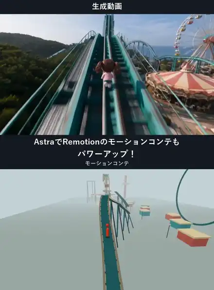</a>

🎬 **[本編を見る →](https://x.com/Kashiko_AIart/status/2096096560690209130)**

#### 📖 説明

これまでに公開された中で最も完成度の高い Astra × Remotion プロンプト（約223いいね / 149ブックマーク）。価値は題材ではなく、**成果物チェックリスト、物理的な接触の検証、そして「カメラがキャラクターを突き抜けてはいけない」という制約**にあります。後に [@Naonekozamurai](https://x.com/Naonekozamurai) がそのまま再利用し、Topview MCP → Seedance 2.5 へ渡しています。

#### 📝 プロンプト

```
Remotionを使い、高低差と多彩なカメラワークを備えた、高速パルクールのモーションコンテを実装・レンダーしてください。計画や静止画だけで終わらず、実際に動くMP4を完成させてください。

【制作条件】
題材は「遊園地のアトラクションを渡り歩く高速パルクール」。題材の指定があれば、その舞台へ置き換えてください。
尺・画面指定がなければ、15秒、横長、SD程度、30fps、無音を初期値とします。軽量で動きを確認しやすい解像度を選んでください。
外部素材がなくても、単純な立体形状で制作を完結できる構成にしてください。

【必須技術】
TypeScriptとRemotionを使用し、useCurrentFrame()を時間の基準として、人物、背景、動く足場、カメラの状態を決定してください。
背景と人物は共通の3D座標系に置き、WebGLで奥行きと遮蔽を描画します。RemotionでプレビューとMP4のレンダーを行ってください。

コース形状、人物の移動経路、姿勢、動く足場、カメラ、描画処理を分離し、後から動作とカメラを編集できる構成にしてください。同じフレーム番号からは常に同じ状態が得られるようにします。

【人物の形と動き】
人物は1体。球形の頭と縦長のカプセル状の胴体からなる、単純な「i型」にしてください。頭と胴体は少し離し、背景から見分けやすい色にします。

四肢や衣装を作り込まず、位置移動、前傾、左右の傾き、軽い上下動、踏み切り前の圧縮、着地時の沈み込みで動作を伝えてください。
走行では短周期の接地感を入れ、加速、跳躍、着地、再加速をつなぎます。
宙返りは身体の向きが空間内で実際に回転するようにし、移動軌道と回転を別々に制御してください。

【コースとアクション】
遊具を、実際に通過・接地できる一続きの立体コースとして配置してください。

基本の流れ：
・ジェットコースターの上りレールを高速で駆け上がる
・曲線レールを急降下する
・レール間の隙間を横宙返りで越える
・ひねり跳躍で動く観覧車のゴンドラ屋根へ飛び移る
・ゴンドラから外周の足場へ跳び、観覧車上部のアーチを走る
・一段低いメリーゴーランドの屋根へ前宙で降りる
・着地ロールから起き上がり、方向転換する
・振り子アトラクションの動く平台へ飛び乗る
・平台からさらに低い屋根へ後宙で降りる
・障害物を跳び越え、曲がる水路沿いを走る
・水路を宙返りで越え、そのまま出口へ疾走する

尺に応じて動作を整理し、各動作の踏み切り、空中移動、接地が読み取れる時間を確保してください。

移動する足場は独立して動かし、接地中の人物は足場の移動へ追従させます。離れた瞬間から人物自身の跳躍軌道へ移行してください。
高さ、距離、足場の幅、回転速度は、接触が成立し、映像でも読める値を設計してください。

背景には支柱、隣接する遊具、屋根、水路、地面などを配置し、人物の移動距離とカメラの視差が分かるようにします。形状は簡素でも、遊具の種類を識別できる輪郭を持たせてください。

【カメラ演出】
次の構図を、アクションの意味に合わせて組み合わせてください。

・真後ろから、進行方向へ伸びるレール越しに追走
・やや斜め後ろから、高低差と次の足場を見せる追走
・横から並走し、跳躍距離や身体の回転を見せる構図
・着地点側に先回りし、こちらへ飛び込んでくる人物を正面で迎える構図
・高所で周囲の地形と落差を見せる広い構図
・次の足場を見る意図を伝える、短い頭部のアップ
・踏み切りや着地の接触を伝える、短い接地部のアップ

正面の迎えでは、カメラを着地点側の一定位置に構える区間を設けてください。人物とカメラの距離が実際に縮まり、人物が画面内で大きくなるようにします。

空中の回転や遊具間の移動では、全身と着地点が読める画角を確保してください。接地部のアップは接触成立後に入れ、次の移動へ素早くつなぎます。

カメラ位置、注視点、画角は連続した軌道でつないでください。背後から正面へ移る際は、人物の周囲を弧を描いて回り込みます。人物を挟んだ2地点を単純に直線補間して、カメラが人物を突き抜けることのない設計にしてください。

構図の名称だけを増やすのではなく、実際の進行方向に対するカメラ位置と、完成映像の見え方に変化を作ってください。

【見た目と速度感】
人物と遊具の形状が読みやすい、簡素な色と照明で仕上げてください。
高速感は、大きな位置変化、短い踏み切り、着地直後の再加速、前景の通過、カメラへの接近で表現します。
映像面は人物と環境で構成し、説明文や制作メモは別資料へまとめてください。

【検証と提出】
レンダー前に、以下を確認・修正してください。
・着地点に支持面があり、接地中の人物が足場へ追従する
・意図しない床抜け、支柱や遊具へのめり込みがない
・人物とカメラの位置、姿勢、画角に不連続や非数値がない
・広い構図では人物全体が画面内に収まる
・頭部と接地部のアップが対象を正しく捉える
・背後、斜め後方、側方、正面の構図が実際に成立する
・正面の迎えで人物がカメラへ接近する

MP4をレンダーした後、ffprobeで尺、解像度、fps、フレーム数、音声の有無を確認し、ffmpegで最後までデコードしてください。
完成動画から各動作とカメラ移行の代表フレームを取り出して目視確認し、可能なら通常速度でも通し再生してください。数値検査と映像の見やすさは別々に検証します。

提出物：
1. 完成したモーションコンテMP4
2. 編集可能なRemotion／TypeScriptソース
3. 動作区間、開始・終了フレーム、カメラ、出力仕様を記載したJSON
4. 再レンダー手順
5. 実施した検証と未確認事項の短い記録

最後に、完成MP4をすぐ開けるリンクを提示してください。
```

<details>
<summary>主要な制約（非公式の要約）</summary>

- 15秒 / 横長 / SD / 30fps / 無音 / 外部素材なし —— 単純な立体形状のみ
- TypeScript + Remotion + `useCurrentFrame()` + 共通の3D座標系 + WebGL
- キャラクター：「i字型」プロキシ1体（球の頭 + カプセル状の胴体）。前傾、踏切前の圧縮、着地時の沈み込みで動きを伝える
- **ハード制約**：カメラはキャラクターを直線的に突き抜けてはいけない／着地点には必ず支持面が必要／同じフレーム番号は常に同じ状態を返す
- **成果物**：MP4 + 編集可能なソース + ショットJSON + 再レンダリング手順 + ffprobe/ffmpeg による検証
</details>

#### 📌 詳細

- **作者：** かし子🍩 ([@Kashiko_AIart](https://x.com/Kashiko_AIart))
- **出典：** [x.com/Kashiko_AIart/status/2096096560690209130](https://x.com/Kashiko_AIart/status/2096096560690209130)
- **再利用：** [@Naonekozamurai](https://x.com/Naonekozamurai/status/2096871096759030114)
- **公開日：** 2026-09-05
- **使用ツール：** GPT-6 Astra, Remotion, TypeScript, WebGL

---

### 2：AdCar TV —— 既存プロダクトリポジトリ内でのワンショット制作

  

<a href="https://x.com/d4m1n/status/2096258259459964963"></a>

🎬 **[本編を見る →](https://x.com/d4m1n/status/2096258259459964963)**

#### 📖 説明

**既存のプロダクトリポジトリ**の中で実行 —— Astra はプロジェクト自身の3Dビューア、音楽、エンジン音をそのまま Remotion に取り込みました。すでに素材があるときの定石です。空のフォルダから始めないこと。

#### 📝 プロンプト

```
can we create an overall video presenting the concept of AdCar TV?

make an intro video of 30-60s showing nice visuals (maybe the 3d of the car)?
and really cool car animations / branded stuff, showing off the site etc.
Use ffmpeg, remotion and qwen 3 tts for voice, and install whatever makes sense,
and come up with a cool artboard first and then make the video.
there is some music and car sounds in the codebase already.
```

> 作者の補足：ffmpeg は主に音声と音楽の貼り付けに使用。Astra はリポジトリ内の既存3Dをそのまま Remotion に読み込ませた。

#### 📌 詳細

- **作者：** Dan ⚡️ ([@d4m1n](https://x.com/d4m1n))
- **出典：** [x.com/d4m1n/status/2096258259459964963](https://x.com/d4m1n/status/2096258259459964963)
- **公開日：** 2026-09-05
- **使用ツール：** GPT-6 Astra, Remotion, ffmpeg, local Qwen 3 TTS

---

### 3：FeatureReveal —— フレーム単位で正確なコンポジション契約

  

#### 📖 説明

ここで最短のプロンプトであり、SaaS のチェンジログ動画を作る際の最良の出発点です。すべてのアニメーションが**フレーム範囲**として指定され、曖昧な記述がありません —— だからこそ推測ではなく実装できるのです。

#### 📝 プロンプト

```
Create a Remotion composition called FeatureReveal.

- 15 seconds at 30fps (450 frames), 1920x1080.
- Dark background (#0d1117).
- A headline "Ship changelogs as video" fades in over frames 0-30,
  holds, then fades out over frames 420-450.
- Three feature rows below the headline, each sliding up from 40px
  with a spring, staggered: row 1 enters at frame 60, row 2 at 90,
  row 3 at 120.
- Register FeatureReveal in Root.tsx with the correct
  durationInFrames and fps.
```

#### 📌 詳細

- **作者：** OpenReplay Team
- **出典：** [blog.openreplay.com/making-videos-claude-code-remotion](https://blog.openreplay.com/making-videos-claude-code-remotion/)
- **公開日：** 2026-06-04
- **対応：** Claude Code, Codex, Astra
- **使用ツール：** Remotion

---

### 4：魔女の初飛行 —— 15秒の生成用ショットスクリプト

  

<a href="https://x.com/Mayz1169/status/2095873015007592679">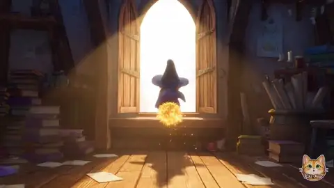</a>

🎬 **[本編を見る →](https://x.com/Mayz1169/status/2095873015007592679)**

#### 📖 説明

**これは入力ではなく出力です** —— Astra が動画モデル向けに*書いた*ショットスクリプト。作者は明言しています：*「このアニメーションのプロンプトを作るために使いました。」* 良い生成用ショットスクリプトの見本として読んでください：秒単位のビート、キャラクターの一貫性ロック、そして長いネガティブリスト。

#### 📝 プロンプト

```
Create a 15-second horizontal 16:9 high-energy fairy-tale animation about a young witch's completely uncontrolled first flight. The entire sequence must stay in fast continuous motion from the first second to the final frame. Bright morning sunlight, rich cheerful colors, whimsical storybook architecture, hand-painted textures and expressive animated acting. Lighthearted magical adventure with playful chase comedy. No dark magic, horror or gloomy atmosphere.

CHARACTER:
A small apprentice witch with a round expressive face, large curious eyes and tousled chestnut hair. She wears a slightly oversized deep-blue pointed hat with a golden star buckle, a short violet cape, a cream blouse, a blue pleated skirt, striped stockings and brown ankle boots. Her old wooden broom has a crooked handle, golden bindings and a slightly messy straw tail. Preserve her face, outfit, hat and broom design consistently throughout the video. Her hat must remain on her head, although she may need to grab it during the dive.

0–1.5s:
Inside the sunlit upper room of a magical academy tower, the apprentice secretly climbs onto the broom while her teacher is facing away. The moment she settles onto it, the broom violently activates with a bright golden spark. It rockets forward before she is ready, dragging her across the room and blasting straight through an open tower window within the first second. Papers, feathers and tiny magical particles spiral behind her. Her eyes widen and she desperately wraps both arms around the broom.

1.5–4s:
The camera rushes alongside her as the broom shoots around the enormous magical academy. She swerves uncontrollably between colorful pointed towers, a giant clock face and suspended stone walkways. She narrowly misses walls and decorative flags. A flock of mail-delivering owls suddenly crosses her path. The broom rolls sideways through the flock while the startled owls scatter in every direction, loose envelopes fluttering through the air. Her expression is pure panic, but the sequence remains playful rather than dangerous.

4–6s:
Without slowing down, the broom turns almost vertically and launches above the towers into soft white clouds. The camera follows from a dramatic low angle as sunlight shines through the cloud mist. At the highest point the broom instantly flips forward and dives toward the valley. Her pointed hat begins lifting from her head, so she grabs it with one hand while clinging to the broom with the other, screaming as her cape and hair stream violently backward.

6–10s:
The dive flows directly into a fast flight through the lively magical town below the academy. The broom skims just above colorful tiled rooftops and twists between narrow streets. She narrowly avoids smoking chimneys, flapping laundry, hanging wooden shop signs and a surprised flying magical postman. The postman spins harmlessly in the air as letters scatter behind him. Use dynamic chase-camera movement, quick side tracking, close passes by foreground objects and strong depth, while keeping the witch's face and broom clearly readable.

10–12.5s:
She bursts over a crowded open-air market, flying above fruit stands and a bright candy shop. The wind trail from the broom sends ribbons, paper wrappers, flower petals and a few lightweight pieces of fruit swirling upward in a colorful spiral. Townspeople and tiny magical creatures look up in astonishment. She ducks beneath a striped market banner, rises over a candy-shop sign and begins pulling the broom handle into a straighter direction.

12.5–15s:
For one brief moment the broom becomes steady. Still racing above the final rooftops, she slowly lifts her head. Her frightened expression changes into a surprised, delighted smile as she begins to enjoy the speed. Before she can celebrate, the broom gives another powerful golden spark and accelerates even faster. She leans forward, laughing and struggling to steer as they blast out of the town and over a green valley toward a magnificent floating castle in the distant sunlit cloud sea. End in the middle of this acceleration with the camera chasing closely behind her, clearly suggesting that the uncontrolled adventure continues.

The story must feel like one flowing pursuit, with each action naturally leading into the next. Keep the broom, witch, environment and camera constantly moving. Use energetic banking turns, dives, rapid elevation changes and near misses, but never show a serious collision or injury. Her emotional progression must remain clear: secret excitement, sudden panic, frantic struggle, then growing exhilaration.

Bright fairy-tale morning lighting, saturated blues, violets, warm golds, fresh greens and candy-colored town details. Soft storybook clouds, sparkling magical trails, fluttering fabric and lively environmental reactions. Fluid animation, clean character silhouette, stable facial features, consistent hands and limbs, coherent broom movement and readable action staging.

No stopping, no landing, no successful mastery of the broom, no final hero pose, no freeze frame, no fade to black, no ending card, no captions, no logos, no dialogue text, no dark fantasy, no night scene, no broken anatomy, no disappearing hat, no duplicated broom and no sudden character or costume changes.
```

#### 📌 詳細

- **作者：** Kiki / Mayz ([@Mayz1169](https://x.com/Mayz1169))
- **出典：** [x.com/Mayz1169/status/2095873015007592679](https://x.com/Mayz1169/status/2095873015007592679) · [返信の全文](https://x.com/Mayz1169/status/2095873204351070296)
- **公開日：** 2026-09
- **使用ツール：** GPT-6 Astra (as prompt writer) → video model

---

### 5：T細胞 —— 一文で、5分

  

<a href="https://x.com/DeryaTR_/status/2095659170661904804">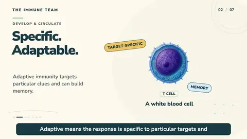</a>

🎬 **[本編を見る →](https://x.com/DeryaTR_/status/2095659170661904804)**

#### 📖 説明

最も多く再共有された例。ユーザープロンプトは文字通り一行です。**非常に短い依頼 + すでに入っている skill が、長いプロンプトに勝つことを証明しています** —— ツールチェーン全体を Astra 自身が選びました。

#### 📝 プロンプト

```
Create a 5 minute educational video about T cells.
```

Astra が選んだ編成（作者が後から説明したもので、元のプロンプトではありませんが、skill フローとして使えます）：

```
Use the Remotion plugin for video generation.
Use Imagegen for visuals.
You may use HeyGen for narration.
Assemble the entire educational video one-shot,
including what to say and how to explain it.
```

#### 📌 詳細

- **作者：** Derya Unutmaz, MD ([@DeryaTR_](https://x.com/DeryaTR_))
- **出典：** [x.com/DeryaTR_/status/2095659170661904804](https://x.com/DeryaTR_/status/2095659170661904804)
- **中国語での二次投稿：** [@LinearUncle](https://x.com/LinearUncle/status/2095719251277701516)
- **公開日：** 2026-09-03
- **使用ツール：** GPT-6 Astra, Remotion plugin, Imagegen, HeyGen

---

### 6：6部構成のコントロールテンプレート + ショットJSON契約

  

#### 📖 説明

どんな Astra タスクにも使える再利用可能な6部構成と、生成器に渡せる JSON ショット契約。**Authority** と **Verification** のブロックは多くの人が省いてしまう部分ですが、まさにこれが、エージェントが余計に質問しすぎたり壊れたものを納品したりするのを防ぎます。

#### 📝 プロンプト

6部構成のコントロールテンプレート：

```
Outcome:
Create [specific deliverable] for [audience and use].

Source of truth:
Use [documents/URLs/data].
Treat [file/version] as authoritative.
Mark any unresolved conflict instead of inventing an answer.

Constraints:
Follow [length, tone, technical, legal or creative rules].

Authority:
Make routine, reversible decisions without asking.
Ask only when missing information would materially change the outcome.

Output contract:
Return [sections/schema/file type], in [order], with [citations/fields].

Verification:
Before finishing, check [acceptance criteria] and repair failures.
```

ショットJSON契約：

```
Return valid JSON with project_summary and shots. Each shot must contain id,
story_purpose, framing, subject_action, camera, duration_seconds,
continuity_constraints and audio_cue. Total duration must equal 45 seconds.
```

60秒のショート：

```
Turn the premise below into a 60-second anime short. Preserve the theme and
character rules. Use 8–10 shots, one primary location and no crowd. Each shot
must change story information. Return logline, beat sheet, dialogue, shot table
and continuity checklist. Remove any beat that cannot be shown or heard.
```

#### 📌 詳細

- **作者：** Elser AI
- **出典：** [elser.ai/blog/gpt-6-astra-prompt-guide](https://www.elser.ai/blog/gpt-6-astra-prompt-guide)
- **公開日：** 2026-09
- **使用ツール：** GPT-6 Astra

---

## 製品ローンチとマーケティング

### Atomik —— 33秒のローンチフィルム

 

<a href="https://x.com/makwanatejas170/status/2096555742597988400"></a>

🎬 **[本編を見る →](https://x.com/makwanatejas170/status/2096555742597988400)**

> 自作の `motion-flavor` skill を使ったワンショットのローンチ映像。この skill は HyperFrames と Remotion の両方で動きます。チャットのプロンプトは公開されておらず、再現可能な実装のほうが公開されています。

X の投稿（原文）：

```
GPT-6 Astra one-shot this launch video for @atomikgrowth
with New motion-flavor skill that i made
works on both @HyperFrames_ & @Remotion
```

リポジトリの仕様 —— エージェントへの受け入れ契約として使えます：

```
Build a 33-second launch film in Remotion + React + TypeScript + CSS/SVG.
1920×1080, 60 fps, 1980 frames, H.264/AAC.
Rocket, layouts, cursor, typography and transitions must be rendered from code.
Portfolio imagery and soundtrack are bundled local media.
Do not hide a finished-video layer inside the composition.
No AI API call is required to render.
Output: out/final-render.mp4
```

**作者：** Tejas ([@makwanatejas170](https://x.com/makwanatejas170)) | **出典：** [x.com](https://x.com/makwanatejas170/status/2096555742597988400) · [ソースリポジトリ](https://github.com/Tejashmakwana/astra-atomik-launch-video) | **公開日：** 2026-09 | **使用ツール：** Astra, Remotion, HyperFrames

---

### video-shotcraft —— シネマティックな製品動画 skill

 

<a href="https://github.com/user-attachments/assets/cba2df8a-4b2e-4247-bace-d0b1dea9c2bd">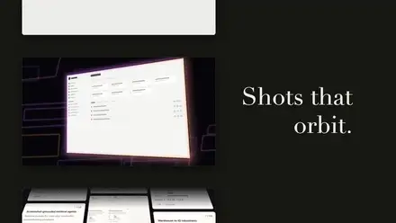</a>

🎬 **[本編を見る →](https://github.com/user-attachments/assets/cba2df8a-4b2e-4247-bace-d0b1dea9c2bd)**

<a href="https://github.com/user-attachments/assets/4cf5af51-98f3-4af2-8ab2-7267f470513d">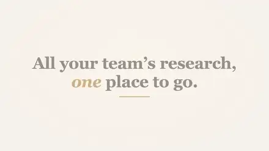</a>

🎬 **[本編を見る →](https://github.com/user-attachments/assets/4cf5af51-98f3-4af2-8ab2-7267f470513d)**

> 157枚のショットレシピカード + Remotion 実装 + 完成映像テンプレート。skill 本体は長いドキュメントで、ここに載せているのはユーザー側の呼び出し方です。

インストール：

```
帮我安装这个 skill：https://github.com/Vincentwei1021/video-shotcraft
```
```bash
npx skills add Vincentwei1021/video-shotcraft
```

呼び出し例（公式 README より）：

```
用 video-shotcraft 给我的桌面产品做一支宣传片。
用 deck-deal-flyin 和 row-embed 两张镜头卡展示这个功能。
参考 spotlight-hero-card，为这个页面设计一个产品特写镜头。
```
```
用 video-shotcraft 的 Ink Press 模板给我的产品做一支宣传片。
```

<details>
<summary>Skill の frontmatter（エージェントがいつ起動するかを決める）</summary>

```yaml
name: video-shotcraft
description: Create cinematic product videos from shot recipe cards, a validated
template, and code/audio assets (Remotion + real page screenshots + 2.5D camera
moves + beat-synced cuts + sound design). Use when the user asks to turn a
frontend project or webpage into a product video, says "use video-shotcraft to
make a video/promo", names the Ink Press template or asks to reproduce its
effect, or wants a single shot card's motion.
```

3つの排他的なモード：Ink Press テンプレートをそのまま適用 · 自律制作（`references/pipeline.md` に従い、途中で確認せず完成カットまで）· 協働（ブリーフ / ビジュアルの方向性 / ショットリストを段階的に確認）。

厳格な制約：実際のページは必ずスクリーンショットを使い、手描きの偽UIは禁止。書体と色は製品のデザイントークンからマッピングすること（汎用の「プロモスキン」ではない）。
</details>

**作者：** Vincentwei1021 | **出典：** [github.com/Vincentwei1021/video-shotcraft](https://github.com/Vincentwei1021/video-shotcraft) | **使用ツール：** Remotion, Astra, Claude Code, Codex

---

### Montage —— エージェントネイティブなローンチ映像の土台

 

> エージェントのために作られた Remotion フォーク。狙いは製品ローンチ映像。

README がエージェントにこう言えと指示している内容：

```
Create a master sequence in a new folder and start creating.
Copy any of the examples to get started.
Reference AGENTS.md and leverage all animations possible.
Replace background primitives and the logo with our branding.
```

AGENTS.md から盗む価値のあるルール：

```
Do NOT one-shot all sections at once without viewing them.
Build one section → register it → render key frames → verify → next section.
Every frame should have something animating.
Never use flat backgroundColor — always layer vignette + grain + corner glow.
Do NOT default to useLetterPopIn for every text entrance.
Use SF Pro Display. Never use Geist or Inter.
After every change: render stills at entrance / mid / settled, inspect, then MP4.
```

**作者：** simplexlabs | **出典：** [github.com/simplexlabs/montage](https://github.com/simplexlabs/montage) | **使用ツール：** Remotion

<a href="https://github.com/user-attachments/assets/e7257684-72e1-47a3-a9e6-0c94b801dc8f">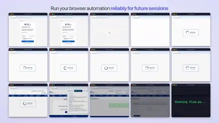</a>

🎬 **[本編を見る →](https://github.com/user-attachments/assets/e7257684-72e1-47a3-a9e6-0c94b801dc8f)**

---

### Remotion 公式 skill の呼び出し

 

> 公式のスラッシュコマンド。コミュニティのプロンプトの多くは、これらが入っている前提で書かれています。

新規プロジェクトでコーディングエージェントに渡す立ち上げ手順：

```
Ensure Node.js is installed.
Install Remotion Skills:
npx -y skills@latest add remotion-dev/skills -g -y
Then use them to create a video.
```

呼び出し：

```
/remotion-create Make a promo video for a record store
/remotion-markup Create an animated title card using Inter
/remotion-maps Animate a route from Los Angeles to New York and make the camera follow it
/remotion-render
/remotion-studio
```

利用可能な skill：`remotion-best-practices`（ルーター）、`remotion-create`、`remotion-markup`、`remotion-studio`、`remotion-render`、`remotion-maps`、`remotion-captions`、`remotion-saas`、`remotion-interactivity`、`remotion-docs`、`remotion-upgrade`、`remotion-multimedia`。

**作者：** Remotion | **出典：** [remotion.dev/docs/ai/skills](https://www.remotion.dev/docs/ai/skills) | **使用ツール：** Remotion

---

### それでも通った極短プロンプト

 

> 最小限の依頼。どこまで少なくできるかの基準として有用ですが、契約書ではありません。

```
游戏做好了，用 remotion 做个好看的 CM
```
**作者：** かな ([@guuchacha149182](https://x.com/guuchacha149182)) | **出典：** [x.com](https://x.com/guuchacha149182/status/2096813471463882947)

<a href="https://x.com/guuchacha149182/status/2096813471463882947">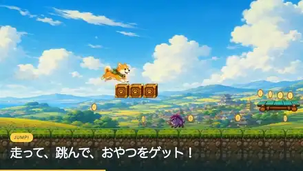</a>

🎬 **[本編を見る →](https://x.com/guuchacha149182/status/2096813471463882947)**

```
根据最近的 changelog 比较亮眼的功能做个视频。
```
**作者：** [@leon7hao](https://x.com/leon7hao) | **出典：** [x.com](https://x.com/leon7hao/status/2096844989900914865) | **備考：** GPT-6-Astra medium、skill 未インストール —— 作者いわく出来は明らかに見劣りした

<a href="https://x.com/leon7hao/status/2096844989900914865">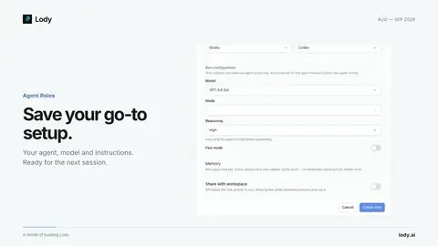</a>

🎬 **[本編を見る →](https://x.com/leon7hao/status/2096844989900914865)**

プロンプトなしで結果だけ投稿されたもの：[@NickYang130](https://x.com/NickYang130/status/2096835902047932521)（BrandNewStudy のマーケティング動画、ワンショット）· [@stoufax](https://x.com/stoufax/status/2096311328600113222)（iOS アプリのローンチ、Remotion + ElevenLabs）· [@nosimaJcrypto](https://x.com/nosimaJcrypto/status/2096834488185528510)（`/goal` + fal 音声 + Remotion プラグイン、90秒のウォークスルー）

**@NickYang130 —— BrandNewStudy のマーケティング動画、ワンショット**

<a href="https://x.com/NickYang130/status/2096835902047932521">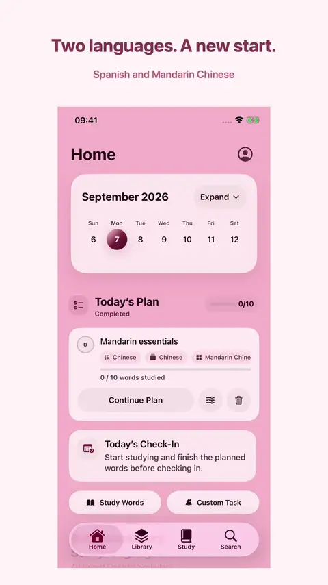</a>

🎬 **[本編を見る →](https://x.com/NickYang130/status/2096835902047932521)**

**@stoufax —— iOS アプリのローンチ、Remotion + ElevenLabs**

<a href="https://x.com/stoufax/status/2096311328600113222">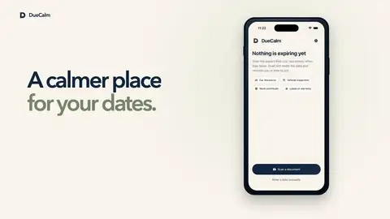</a>

🎬 **[本編を見る →](https://x.com/stoufax/status/2096311328600113222)**

---

## モーションコンテ → 生成

> この系統は、動画モデルに絵を説明するのではなく、まず Astra に Remotion で **control MP4** をレンダリングさせ、それを Seedance などにモーション参照として渡します。日本のシーンでは、ますます主流の第2の工程になりつつあります。

### Seedance への引き渡し指示

 

<a href="https://x.com/Naonekozamurai/status/2096871096759030114">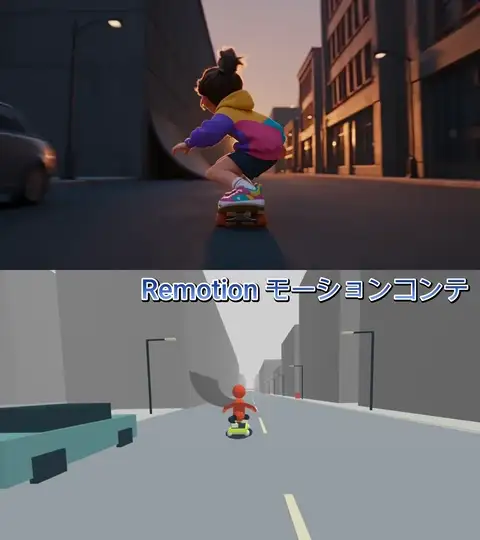</a>

🎬 **[本編を見る →](https://x.com/Naonekozamurai/status/2096871096759030114)**

> Remotion のレンダリング結果を生成モデルに渡すときの言い方。修正の許可を明示しないと、モデルはプレースホルダの欠陥を忠実に再現してしまいます。

```
Remotionで作成した動画はあくまで動きを参照するだけの動画。
参照動画で不自然な挙動や不自然な女の子の体勢は、動画化の際にどんどん修正して良い。
動画では、前後のつながり、動画としてのかっこよさを重視してほしい。
```

<details>
<summary>英語（非公式）</summary>

```
The video made with Remotion is purely a reference for movement.
Any unnatural behavior or unnatural poses of the girl in the reference video
may be freely corrected during video generation.
In the video, prioritize continuity between shots and how good it looks as a video.
```
</details>

**作者：** なお ([@Naonekozamurai](https://x.com/Naonekozamurai)) | **出典：** [x.com](https://x.com/Naonekozamurai/status/2096871096759030114) | **公開日：** 2026-09 | **使用ツール：** Remotion → Seedance 2.5（Topview MCP 経由）

---

### 超高速疾走 control MP4

 

<a href="https://x.com/Kashiko_AIart/status/2094182215894831283">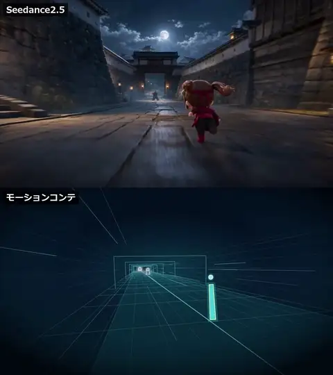</a>

🎬 **[本編を見る →](https://x.com/Kashiko_AIart/status/2094182215894831283)**

> チート防止条項に注目：背景をループさせるのではなく、十分に長い一本道を作り、実際に前進させること。そして**人物とグリッドは必ず同じ3D座標系とカメラ投影を使う** —— 2D素材を拡大縮小するだけの疑似カメラは禁止です。

```
Remotionで超高速疾走モーションコンテを作ってください。フレーム単位で実際に動く3Dドローン追従型のcontrol MP4を出力。
固定された一つの3Dワールドとして構築し、床グリッド、左右の壁線、一定間隔のゲート、空間中の光跡を配置する。背景をループさせるのではなく、十分に長い一本道を実際に前進させる。
キャラクターは疾走するキャラクターをやや斜め後ろから追従する。
人物とグリッドは必ず同じ3D座標系とカメラ投影を使用してください。2D素材を拡大縮小するだけの疑似カメラにはしないでください。

【人物proxy】
全員、次の2要素だけで表現する。
1. 円形の頭
2. 傾きや回転が可能な一本の縦長胴体

【疾走速度】
見かけだけの速度表現ではなく、root座標を毎フレーム実際に前進させる。

【敵と接触frame】
敵は接触frameを決定してコース上へ固定配置する。
キャラクターは流れるような体術で3体を進行軸の外へ弾き、そのまま走り抜ける。
カメラは接触の前後だけ、短いイージングで別アングルへ移行し、接触後は必ず後方追従へ戻す。

【クリーンcontrol画面】
映像内には人物proxy、空間、接触アクセントだけを表示する。
```

**作者：** かし子🍩 ([@Kashiko_AIart](https://x.com/Kashiko_AIart)) | **出典：** [x.com](https://x.com/Kashiko_AIart/status/2094182215894831283) | **使用ツール：** Astra, Remotion

---

### 横スクロール追従、フレーム表付き

 

<a href="https://x.com/Kashiko_AIart/status/2093692302745383041">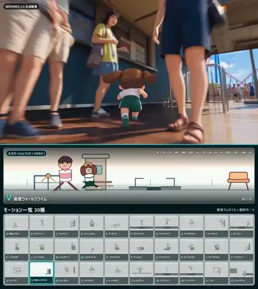</a>

🎬 **[本編を見る →](https://x.com/Kashiko_AIart/status/2093692302745383041)**

> 収録中で最もフレーム精度の高いプロンプト。すべてのパルクール動作に明示的なフレーム範囲が割り当てられ、半開区間の意味まで書き切っています。

```
Remotionで1920×1080の、横スクロール追従式モーションコンテを作ってください。

夏の光が差す、来園者でにぎわう現代的な遊園地を舞台に、短パン姿のかし子が先頭を逃げ、成人のママが後方から追います。二人を色分けしたシンプルな全身2.5Dプロキシで表現し、入場ゲート、待機列の柵、壁、高低差のある足場、ベンチ、低い柵、回転木馬の支柱、水路、コースター軌道を、左から右へ続く一つのコースとして配置してください。

動作順は、P パームスピン → Q クイックステップ → V 垂直ウォールクライム → W ウォールラン → AB コークスクリュー → AD ドロップロール → A 加速スプリント → O ワンハンドヴォルト → B バックフリップ → S スピードヴォルト → R リバースヴォルト → AD ドロップロール → AC ラシェ → AB コークスクリュー → A 加速スプリントです。

時間境界は、P 0–20f、Q 20–72f、V 72–116f、W 116–132f、AB 132–156f、AD 156–168f、A 168–176f、O 176–188f、B 188–224f、S 224–236f、R 236–252f、AD 252–260f、AC 260–286f、AB 286–316f、A 316–361fとします。開始frameを含み、終了frameを含まない区間として扱ってください。

カメラは最後まで真横から少しだけ立体感のある横追走を維持し、約4300pxのコースをスクロールさせながら、かし子を画面左から約720pxの位置へ保ちます。上下補正は±18px以内とし、予備動作、踏切、手足の接触、重心移動、着地、回復が常に読める大きさにしてください。

Qは横方向の移動だけを52fへ延ばし、腕脚と上下の踏み替えは元の16f周期を等倍で反復します。Vも登る位置は44fで進めながら、腕脚は元の26f周期で等倍動作させます。全身をスロー再生にせず、左右の関節を正しく接続し、通常時の脚は腰から下へ伸ばし、足先は自然な外向きのハの字にしてください。

画面上へタイトル、コード、字幕、矢印、一覧、制作メモなどのUIを表示しないclean-control映像とします。音声なしのH.264 MP4を `motion-conte-control.mp4` としてレンダーし、各動作のコード、名称、開始・終了frameを `motion-conte-manifest.json` に保存してください。
```

**作者：** かし子🍩 ([@Kashiko_AIart](https://x.com/Kashiko_AIart)) | **出典：** [x.com](https://x.com/Kashiko_AIart/status/2093692302745383041) | **使用ツール：** Astra, Remotion

---

### 30種類のカメラ構図 —— リファレンスシート生成

 

<a href="https://x.com/Kashiko_AIart/status/2093575541916061984">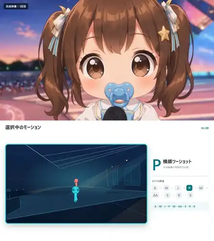</a>

🎬 **[本編を見る →](https://x.com/Kashiko_AIart/status/2093575541916061984)**

> 動画モデルと話すときに ID で参照できる、閲覧可能なカメラ構図カタログを作ります。

```
RemotionとHTML、CSS、SVGを使って、動画生成AIへカメラ構図と連続したカメラ移動を伝えるための「カメラ構図一覧」と「モーションコンテ」を作ってください。

30種類の重複しないカメラ構図を、HTML画面上の6列×5行グリッドに並べてください。

各パネルには以下を表示します。
・ID：A〜Z、AA〜AD
・構図名
・16:9の構図サムネイル

被写体は、位置、向き、傾きだけが分かるシンプルなi字人形を2体使います。人物Aはシアン、人物Bはオレンジにして、二人の位置関係を判別しやすくしてください。背景、ステージ、客席、家具なども単純なSVG図形で表現してください。

全景、ツーショット、各人物の寄り、肩越し、横顔、俯瞰、あおり、主観、前景越し、背面、周回など、重複しない30種類を作ってください。
```

> ⚠️ 投稿は出力要件の先まで続きますが、ここでは見えている部分のみ引用しています。

**作者：** かし子🍩 ([@Kashiko_AIart](https://x.com/Kashiko_AIart)) | **出典：** [x.com](https://x.com/Kashiko_AIart/status/2093575541916061984) | **使用ツール：** Astra, Remotion, HTML/CSS/SVG

> 同じ作者が *ちゃんばら* のワークフローも公開しています —— [x.com](https://x.com/Kashiko_AIart/status/2096533732547264921) —— ただし方法のみでプロンプトは非公開：1) カメラと人物位置だけの最小ショットリスト、2) エフェクトのサンプルシート、3) プロンプトで制御する細かい動き。

<a href="https://x.com/Kashiko_AIart/status/2096533732547264921">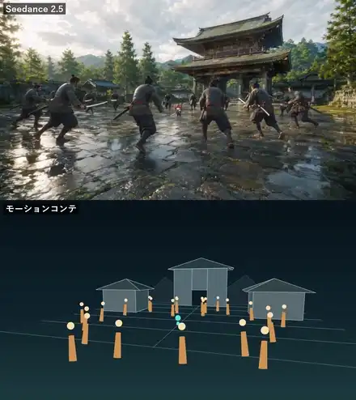</a>

🎬 **[本編を見る →](https://x.com/Kashiko_AIart/status/2096533732547264921)**

---

## エンドツーエンド制作

### アイデア → そのまま公開できる YouTube 動画

 

> 約50分、API コストはおよそ60ドル。肝は「下書きは受け取らない」という一行です。

```
I need you to take me from idea to finished YouTube video.
I want you to create me an engaging and professional video about GPT-6 Astra.
You need to use Nate Herk's voice clone and HeyGen avatar.

Start the video off by telling everyone that this is not Nate
and that you orchestrated the entire video.
You planned it out. You researched it. You grabbed all the B-roll.
You grabbed the screenshots, you edited everything,
and you produced a finished video, which is what they're watching right now.

I want this to feel professional, like it was edited by a human using HyperFrames.
Do not give me a draft or a WIP.
Give me a finished working version that I can post on my YouTube channel.
```

同じ作者による、152GB のイベント素材から作ったダイジェスト：

```
Create me a sizzle reel recap that's a minute long from this event.
```

> ⚠️ 動画のナレーションから文字起こししたものです —— 公式のコピペ用テキストは存在しません。

**作者：** Nate Herk | **出典：** [youtube.com/watch?v=dT5-x3u5nCg](https://www.youtube.com/watch?v=dT5-x3u5nCg) · [ダイジェスト映像](https://www.youtube.com/watch?v=QhmhUgccaS0) | **使用ツール：** Astra, HeyGen, ElevenLabs, HyperFrames

---

### ナレーション先行の図解動画

 

> 生成映像は一切なし。先に録音し、計測したナレーションのキューに合わせて絵を作ります。

ワークフロー：

```
1. write and record the explanation
2. mark the moments where the picture needs to change
3. ask Astra to build those moments with shapes, labels and motion in Remotion
4. add captions timed to the recording
5. render and watch with sound
```

公開されている短い指示：

```
Use this image for the scene, plan the framing around the measured narration cues,
keep important details visible and stop the movement while the viewer reads the label
```

```
Bring the result on screen when the recording names it,
shorten the entrance animation and preserve the time needed to read the final state
```

> ⚠️ 作者の10本の Master Prompts は有料バンドルに含まれ、公開されていません。ここには公開された骨組みのみを掲載しています。

**作者：** Foma ([@foma_on_x](https://x.com/foma_on_x)) | **出典：** [x.com](https://x.com/foma_on_x/status/2096845194788217049) および以降の投稿 | **使用ツール：** Astra, Remotion

---

## メタ：プロンプトを書くプロンプト

### 監督 / アニメーションスーパーバイザーのテンプレート

 

> そのまま本番で使えるプロンプトに*加えて*、ネガティブプロンプトと3つの代替調整案を出します —— 最後の項目がほとんどのテンプレートに欠けています。

```
Act as a film director, animation supervisor and prompt engineer.

Develop a complete prompt for a [DURATION]-second animated sequence.

Story:
[Describe what happens.]

Define:
Character appearance
Environment
Opening composition
Camera movement
Character actions
Timing and pacing
Lighting
Color palette
Emotional tone
Final shot

Maintain visual and narrative continuity throughout the sequence.
Every movement should connect naturally to the next.

Return:
1. The final production-ready prompt
2. A shot-by-shot breakdown
3. A negative prompt identifying unwanted outcomes
4. Three adjustments I can make if the first generation is inconsistent
```

**作者：** The AI Average | **出典：** [theaileverage.beehiiv.com](https://theaileverage.beehiiv.com/p/the-gpt-6-astra-build-guide) | **使用ツール：** GPT-6 Astra

---

## 隣接領域：Blender ほか

### Blender 8秒の製品ターンテーブル

 

> 全編の前に静止画をレンダリングする手順に注目 —— カメラ軌道の失敗を最も安く検出する方法です。

```
Make an eight-second product animation from the starter at 1920 × 1080, 24 fps,
frames 1–192.
Move the camera from a right-front elevated view to a left-front view,
easing at the beginning and end.
Keep the product stationary, the cyan indicator visible, and the lighting deliberate.
Preserve the enclosure dimensions.
Render frames 1, 96, and 192 before the full sequence.
Save animation_v001.blend.
```

**作者：** Kingy.ai | **出典：** [kingy.ai/blog/blender-openai-astra-complete-guide](https://kingy.ai/blog/blender-openai-astra-complete-guide/) | **使用ツール：** Blender, Astra

---

### 存在は確認できるが未公開

> 存在は確認済み、公開された一次情報はなし。**掲載のみ、復元はしない。**

| 何が | 誰が | 状態 |
|---|---|---|
| 物理 / ソフトボディのモーション skill —— Remotion/HyperFrames のフェードインカードを捨て、物理的な手応えとソフトボディの力で見せる、4K60 | [@paojiaofty](https://x.com/paojiaofty/status/2096830622341976467) | 予告済み、skill は未公開 |
| Higgsfield + Blender プリビズ + Seedance 2.5 のちゃんばらパイプライン | 二次報道のみ | 一次情報ではない |
| `motion-flavor` skill のソース | [@makwanatejas170](https://x.com/makwanatejas170) | 単体では未公開 |
| 図解動画用の10本の Master Prompts | [@foma_on_x](https://x.com/foma_on_x) | 有料バンドル |
| 「Remotion 制作 8本の裏側」長文note | [@chikaidev](https://x.com/chikaidev) | 未文字起こし |
| 返信で主張された5本のモーションプロンプト | [@dawoodkhan254](https://x.com/dawoodkhan254) | 主張のみ、未投稿 |

**物理 / ソフトボディのデモ映像自体は公開されています**（skill は非公開）：

<a href="https://x.com/paojiaofty/status/2096830622341976467">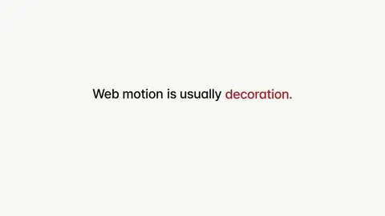</a>

🎬 **[本編を見る →](https://x.com/paojiaofty/status/2096830622341976467)**

---

## Skill とツール

ここに集まる全員が、Astra に同じ土台を入れています。リンクは貼りますが、同梱はしません。

| ツール | インストール / リンク | 用途 |
|---|---|---|
| **Remotion Agent Skills** | `npx skills add remotion-dev/skills` | ほぼすべての事例の下にある土台 |
| **Remotion system prompt** | [remotion.dev/docs/ai/system-prompt](https://www.remotion.dev/docs/ai/system-prompt) | `SKILL.md` / `AGENTS.md` に貼るもの —— ユーザーのタスク用プロンプトではない |
| **Remotion Studio WebMCP** | 4.0.518+ | スクリーンショットをクリックせず、選択範囲・タイムライン・ジオメトリを直接読む |
| **video-shotcraft** | [github](https://github.com/Vincentwei1021/video-shotcraft) | 157枚のショットレシピカード + テンプレート |
| **Montage** | [github](https://github.com/simplexlabs/montage) | ローンチ映像向けのエージェントネイティブな Remotion フォーク |
| **astra-atomik-launch-video** | [github](https://github.com/Tejashmakwana/astra-atomik-launch-video) | 再現可能なローンチ映像のソース |
| **awesome-gpt-6-astra** | [github](https://github.com/xianyu110/awesome-gpt-6-astra) | より広範なコミュニティリスト |

---

## コミュニティが学んだこと

上記すべてのスレッドに共通して現れるパターン：

**まず skill を入れ、それから話す。** skill なしでは、チェンジログ動画は「明らかに物足りない」出来でした。入れてからは、ワンショットが当たり前になりました。

**求めるのは成果物であって、雰囲気ではない。** ここで最強のプロンプト（かし子さんのもの）は、MP4 + 編集可能なソース + ショットJSON + 再レンダリング手順 + ffprobe による検証、で締めています。

**「全体をもっと速く」ではなく、タイムラインをナレーションに合わせる。** Foma の解決策はその瞬間を名指しすることです：*ナレーションが結果を言うときには、絵はもうそこにある必要がある。*

**空のフォルダより、プロダクトリポジトリの中で走らせるほうが強い。** AdCar、Atomik、そしてゲームの CM も、いずれも既存の素材を引き込んでいます。

**Remotion をプリビズに、生成モデルを本番に**という流れが、日本のシーンでは標準の第2工程になりつつあります。

**Astra が最も力を発揮するのは編成と再設計** —— [@paojiaofty](https://x.com/paojiaofty) はフェードインカードを受け入れるくらいなら、フレームワークごと捨て去りました。

**「ワンショット」という主張に対して、開示を求める動きが出ています：** 空のリポジトリか既存プロジェクトか？推論ティアは？何回リトライした？skill は事前に入っていた？必須項目にする価値があります。

---

## 完全性の一覧

| ID | 種類 | 作者 | 全文あり？ |
|---|---|---|---|
| AdCar TV | 製品ローンチ | [@d4m1n](https://x.com/d4m1n) | ✅ |
| Atomik | 製品ローンチ | [@makwanatejas170](https://x.com/makwanatejas170) | 仕様はあり、チャットのプロンプトはなし |
| video-shotcraft | 製品プロモ skill | Vincentwei1021 | 呼び出しはあり、skill 本体は長い |
| Montage | ローンチの土台 | simplexlabs | AGENTS.md のルール |
| FeatureReveal | 機能紹介動画 | OpenReplay | ✅ |
| Remotion 公式 | 呼び出し | Remotion | ✅（ごく短い） |
| パルクールのコンテ | モーションコンテ | [@Kashiko_AIart](https://x.com/Kashiko_AIart) | ✅ |
| 疾走 control MP4 | モーションコンテ | [@Kashiko_AIart](https://x.com/Kashiko_AIart) | ✅ |
| 横スクロール追従 | モーションコンテ | [@Kashiko_AIart](https://x.com/Kashiko_AIart) | ✅ |
| カメラ構図30種 | リファレンス | [@Kashiko_AIart](https://x.com/Kashiko_AIart) | partial |
| Seedance 引き渡し | 引き渡し | [@Naonekozamurai](https://x.com/Naonekozamurai) | ✅ |
| T細胞 | 解説動画 | [@DeryaTR_](https://x.com/DeryaTR_) | ✅（一行） |
| Nate の YouTube | チャンネル動画 | Nate Herk | 文字起こし |
| Foma の図解 | 図解動画 | [@foma_on_x](https://x.com/foma_on_x) | 短い指示のみ |
| 魔女の初飛行 | 生成用ショットスクリプト | [@Mayz1169](https://x.com/Mayz1169) | ✅ |
| 6部構成 + JSON | メタ | Elser AI | ✅ |
| 監督テンプレート | メタ | The AI Average | ✅ |
| Blender ターンテーブル | 3D製品 | Kingy.ai | ✅ |
| 物理モーション skill | skill | [@paojiaofty](https://x.com/paojiaofty) | 未公開 |

---

## ウォッチリスト

GitHub Action が6時間ごとにこれらのアカウントを確認し、動画プロンプトらしい投稿があれば Issue を立てます。

| アカウント | 理由 |
|---|---|
| [@Kashiko_AIart](https://x.com/Kashiko_AIart) | 最長の Remotion モーションコンテプロンプトの出所 |
| [@Naonekozamurai](https://x.com/Naonekozamurai) | Remotion コンテ → Seedance、実践派 |
| [@makwanatejas170](https://x.com/makwanatejas170) | motion-flavor skill / Atomik |
| [@paojiaofty](https://x.com/paojiaofty) | 予告された物理モーション skill |
| [@foma_on_x](https://x.com/foma_on_x) | 図解動画のワークフロー |
| [@DeryaTR_](https://x.com/DeryaTR_) | 一行の依頼 |
| [@d4m1n](https://x.com/d4m1n) | リポジトリ内でのワンショット |
| [@TROOVY](https://x.com/TROOVY) | プロのモーションスタジオの視点 |

[アカウントを提案する →](../../issues/new?template=watch-account.yml)

---

## 投稿方法

**[→ プロンプトを投稿する](../../issues/new?template=new-prompt.yml)** —— 貼り付けて、出典をリンクするだけ。git は不要です。

各項目には3つ必要です：

| 項目 | なぜ必要か |
|---|---|
| **作者** | 名前やハンドル。本人が書いている表記のまま |
| **出典** | 投稿・スレッド・ブログ・動画への直接リンク |
| **公開日** | どれだけ新しいかを読者が判断できるように |

**ルール：**

- **一字一句そのまま引用する。** 整えない、言い換えない、「改善」しない。
- **原文の言語を保つ。** 訳文は `<details>` ブロックに入れ、非公式と明記すること —— 原文を置き換えてはいけない。
- **欠けている部分を創作しない。** スクリーンショットで半分しか写っていないなら、`partial` と明記し、見えている部分だけを引用する。
- **公式ドキュメントはリンクする。コピーしない。** API は変わるので、古いコピーは誤解を招く。

詳しくは [CONTRIBUTING.md](CONTRIBUTING.md) を参照してください。

---

## ライセンスと謝辞

リポジトリの構成・編集メモ・スクリプト：[CC BY 4.0](LICENSE)。

**プロンプトの著作権は各作者に帰属します。** 出典と原文へのリンクを添えて、参照と研究のために引用しています。

エージェント駆動の動画制作をオープンに進めるすべての人に感謝します —— [かし子](https://x.com/Kashiko_AIart)、[なお](https://x.com/Naonekozamurai)、[Dan](https://x.com/d4m1n)、[Tejas](https://x.com/makwanatejas170)、[Foma](https://x.com/foma_on_x)、[Derya Unutmaz](https://x.com/DeryaTR_)、[Kiki](https://x.com/Mayz1169)、Nate Herk、OpenReplay、Elser AI、The AI Average、Kingy.ai、Vincentwei1021、simplexlabs、そして Remotion チーム。

**あなたもその一人ですか？**[Issue を作成](../../issues/new?template=correction.yml)すれば、クレジットの修正、プロンプト全文の追加、作品の削除ができます。異議なく対応します。

---

<div align="center">

役に立ったら ⭐ **このリポジトリに Star を** —— 他の人がそれで見つけます。

<a href="https://www.luxreal.com/?utm_source=GitHub&utm_medium=readme&utm_campaign=astra_prompts"><picture><source media="(prefers-color-scheme: dark)" srcset="https://raw.githubusercontent.com/LuxRealGrowth/awesome-astra-video-prompts/main/media/luxreal-logo-dark.png"></picture></a>

[Discord](https://discord.gg/EUgCVYQFJJ) · [LuxReal](https://www.luxreal.com/?utm_source=GitHub&utm_medium=website&utm_campaign=shortdrama_skills)

</div>
